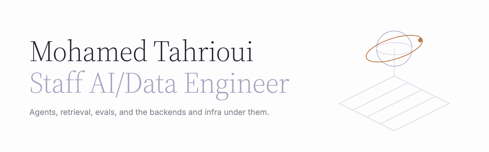

  

   
   

  
  

   
   

## Staff AI/Data Engineer

I ship products end-to-end: agents, retrieval, evals, and the backends and infra under them. Open to staff engineering roles at early-stage AI startups.

### Stack

|  |  |
| --- | --- |
| **Languages** | Python, Go, Rust, TypeScript |
| **Data** | Postgres, MySQL, SQLite, Redis, Qdrant |
| **Infra** | Linux, Docker, Kubernetes, Terraform, Helm, AWS |
| **Async** | Kafka, RabbitMQ, SQS/SNS, Temporal, DBOS |
| **Observability** | OpenTelemetry, Prometheus, Grafana |
| **AI systems** | RAG pipelines, eval harnesses, guardrails |

### Recent projects

<!--RECENT_PROJECTS:start-->

- **[cadboss](https://github.com/4thel00z/cadboss)** • Rust - latest release: [v0.1.1](https://github.com/4thel00z/cadboss/releases/tag/v0.1.1) (2026-11-05)
- **[gaebboss](https://github.com/4thel00z/gaebboss)** - GAEB DA XML in pure Rust: read tenders and bids, validate, write schema-valid X84, price a tender. One core, a CLI and a Python package. • Rust - latest release: [v0.4.0](https://github.com/4thel00z/gaebboss/releases/tag/v0.4.0) (2026-11-05)
- **[pptxboss](https://github.com/4thel00z/pptxboss)** - PowerPoint engine written from scratch in Rust: reads .pptx and legacy .ppt, extracts text, notes, tables, charts and images, renders Markdown, verifies against ECMA-376, creates decks. CLI and Python bindings. • Rust - latest release: [v2.3.0](https://github.com/4thel00z/pptxboss/releases/tag/v2.3.0) (2026-11-05)
- **[4thel00z](https://github.com/4thel00z/4thel00z)** - My github frontpage.
- **[docboss](https://github.com/4thel00z/docboss)** - Word engine written from scratch in Rust: reads .docx and legacy .doc, extracts text, Markdown, HTML and JSON, renders pages to PNG, writes DOCX, opens encrypted and remote files, checked against ECMA-376 and [MS-DOC] with a Lean ledger. CLI, Python bindings and a terminal explorer. • Rust - latest release: [v0.2.1](https://github.com/4thel00z/docboss/releases/tag/v0.2.1) (2026-11-04)
- **[qdrant-operator](https://github.com/4thel00z/qdrant-operator)** - Kubernetes operator for Qdrant: Helm-managed clusters, multi-node S3 backups, scheduled backups and restores • Python - latest release: [v0.3.2](https://github.com/4thel00z/qdrant-operator/releases/tag/v0.3.2) (2026-09-24)
- **[pdfboss](https://github.com/4thel00z/pdfboss)** - From-scratch Rust PDF toolkit for Python: fast page rendering and text extraction via PyO3. Benchmarked faster than mainstream Python PDF libraries • Rust - latest release: [v2.16.1](https://github.com/4thel00z/pdfboss/releases/tag/v2.16.1) (2026-10-28)
- **[arroyo-python](https://github.com/4thel00z/arroyo-python)** - Crash-resumable Parquet streaming to S3 from Python: one multipart upload per file, checkpoints a new process can finish, parallel reads. Rust + PyO3. • Rust - latest release: [v0.1.2](https://github.com/4thel00z/arroyo-python/releases/tag/v0.1.2) (2026-11-01)
<!--RECENT_PROJECTS:end-->
